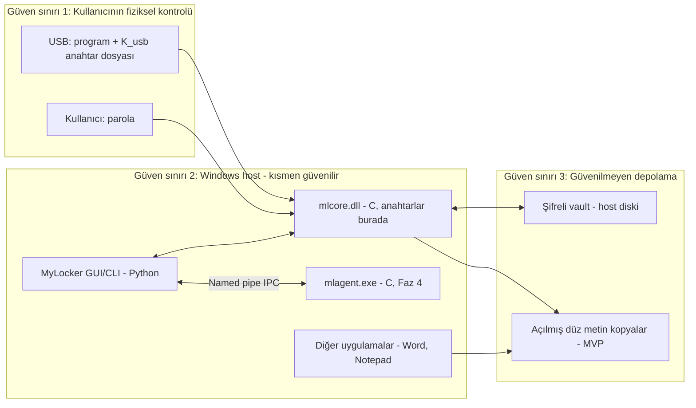

# MyLocker — Tehdit Modeli (v1)

> Bu belge projenin **güvenlik sözleşmesidir**. Kodda verilen her güvenlik kararı buradaki bir varlığa, saldırgana veya hedefe referans vermelidir. Belge her fazın sonunda güncellenir (v1 → MVP, v2 → Agent, v3 → VFS).

Yöntem: Sistem tanımı + güven sınırları → varlıklar → varsayımlar → saldırgan profilleri → hedefler / hedef dışı konular → senaryo analizi → STRIDE → kalan riskler. (Shostack, *Threat Modeling*, 2014; Microsoft STRIDE.)

---

## 1. Sistem tanımı ve güven sınırları

Temel ilke: **Host diski her zaman güvenilmez kabul edilir.** Host işletim sistemi yalnızca *kilit açma oturumu sırasında* geçici olarak güvenilir kabul edilir (bkz. TA2).

---

## 2. Varlıklar

| ID | Varlık | Neden değerli |
|---|---|---|
| AS-1 | Dosya içerikleri (düz metin) | Asıl korunan veri |
| AS-2 | Metadata: dosya adları, klasör yapısı, boyutlar, zaman damgaları | Adlar bile hassas olabilir (`istifa_mektubu.docx`) |
| AS-3 | `K_usb` (USB kök sırrı, 256 bit) | Vault'u açmanın bir faktörü |
| AS-4 | Kullanıcı parolası | İkinci faktör |
| AS-5 | VMK / dosya anahtarları (bellekte) | Ele geçerse tüm vault açılır |
| AS-6 | Vault bütünlüğü | Sessiz manipülasyon fark edilmeli |
| AS-7 | Erişilebilirlik / veri kaybı olmaması | Şifreleme yazılımının en sık hatası veri kaybıdır |
| AS-8 | Yazılım bütünlüğü (USB'deki program, agent) | Yamalanmış program anahtarı sızdırır |
| AS-9 | Kurtarma anahtarı | USB kaybında tek kurtuluş |

---

## 3. Güven varsayımları (Trust Assumptions)

| ID | Varsayım | İhlal edilirse |
|---|---|---|
| TA1 | USB, kullanımda değilken kullanıcının fiziksel kontrolündedir. | ADV-6/ADV-7 senaryosu; 2FA modu devreye girer. |
| TA2 | Kilit açma anında ve vault açık kaldığı sürece host'ta (kernel dahil) kötü niyetli kod yoktur. | Açık veri ve anahtarlar korunamaz (ADV-4, ADV-5). |
| TA3 | AES-256-GCM, HKDF-SHA256, HMAC-SHA256, Argon2id kriptografik olarak güvenlidir; kütüphane (libsodium / OpenSSL) doğru implement edilmiştir. | Tüm kriptografik garantiler düşer. |
| TA4 | İşletim sisteminin CSPRNG'si (BCryptGenRandom / RtlGenRandom) doğru çalışır. | Anahtarlar tahmin edilebilir olur. |
| TA5 | 2FA modunda kullanıcı makul entropide parola seçer. | USB çalınırsa parola kaba kuvvetle kırılabilir. |
| TA6 | Donanım, firmware ve USB denetleyicisi güvenilirdir. | BadUSB, DMA, firmware implantları kapsam dışıdır. |

---

## 4. Saldırgan profilleri

| ID | Saldırgan | Yetenekler | USB durumu |
|---|---|---|---|
| ADV-1 | Yerel standart kullanıcı (başka hesap) | Kendi hesabıyla dosya okuma; ACL'lerle sınırlı | Yok |
| ADV-2 | **Yerel Administrator / SYSTEM — ana saldırgan** | ACL değiştirme, `takeown`, `SeBackupPrivilege`, ham disk okuma (`\\.\PhysicalDrive0`), VSS, programı silme/değiştirme, vault'u kopyalama | **Takılı değil** |
| ADV-3 | Çevrimdışı adli saldırgan | Disk imajı alır, başka OS'tan boot eder, dosya oyma (carving) yapar | Yok |
| ADV-4 | Çevrimiçi Administrator (oturum sırasında) | ADV-2 + açık süreçlerin belleğini okuma, keylogger, DLL injection | **Takılı** |
| ADV-5 | Kalıcı saldırgan (Evil Maid) | Kullanıcı yokken host'a implant/yamalı agent yerleştirir, kullanıcının bir sonraki kilit açmasını bekler | Sonra takılacak |
| ADV-6 | USB'yi çalan / bulan kişi | USB'nin tüm içeriği; vault'a da erişebilir | Saldırganda |
| ADV-7 | USB klonlayıcı | USB'ye kısa süreli erişip birebir kopyalar, sonra iade eder | Kopyası saldırganda |
| ADV-8 | Kernel / firmware / donanım saldırganı | Rootkit, DMA (Thunderbolt), cold boot | Herhangi |
| ADV-9 | Uzak zararlı yazılım (kullanıcı yetkisinde) | Kullanıcı yetkisiyle kod çalıştırır | Herhangi |

---

## 5. Güvenlik hedefleri

### G1 — Durağan veride gizlilik (Confidentiality at rest)
TA1, TA3, TA4 altında; ADV-1, ADV-2, ADV-3 sınıfındaki **SYSTEM yetkisine sahip olsa bile** bir saldırgan, şifreli vault'a sınırsız erişimi olsa dahi, dosya içeriklerini ve dosya adlarını aşağıdaki **izin verilen sızıntı kümesi L**'nin ötesinde öğrenemez:

> L = { vault'un varlığı, şifreli blob sayısı, her blob'un yaklaşık boyutu (chunk başına +28 bayt), blob dosyalarının NTFS zaman damgaları, kilitleme/açma zamanları }

Bu, AES-256-GCM'in IND-CCA güvenliğine ve 256-bit `K_usb`'nin tahmin edilemezliğine indirgenir.

**Ön koşul (kritik):** İlgili dosyanın düz metni host diskine hiç yazılmamış olmalı **veya** yazılmış kalıntıları üzerine yazılmış olmalıdır. MVP'nin "çöz → düzenle → şifrele" modeli bu ön koşulu **ihlal eder** (bkz. §9 ve §10). Bu, VFS fazının ana motivasyonudur ve ölçülebilir bir deneyle gösterilecektir (test T-13).

### G2 — Bütünlük ve özgünlük
Header, metadata, chunk, manifest üzerinde yapılan her değişiklik; chunk'ların yeniden sıralanması, kesilmesi (truncation), eklenmesi, çoğaltılması; dosyaların vault içinde veya vault'lar arasında yer değiştirmesi **tespit edilir** ve sistem **kapalı başarısız olur** (fail-closed): doğrulanmamış hiçbir düz metin bayt diske yazılmaz.
*İstisna:* Tüm vault'un eski bir tutarlı kopyayla değiştirilmesi (rollback) yalnızca USB'de tutulan epoch sayacı ile tespit edilir (Faz 5). Vault'un tamamen silinmesi engellenemez (G6'ya bakınız).

### G3 — İki faktör (varsayılan mod)
- Yalnızca USB içeriğine sahip olmak (ADV-6, ADV-7) yeterli değildir: saldırgan parolayı Argon2id maliyetiyle kaba kuvvet denemek zorundadır.
- Yalnızca parolayı bilmek yeterli değildir: 256-bit `K_usb` gerekir.
- "Yalnızca USB" modu desteklenir ama kullanıcıya açıkça "USB kopyası = anahtar kopyası" uyarısı verilir.

### G4 — Anahtar hijyeni
Anahtarlar düz halde yalnızca `mlcore`/`mlagent` sürecinin **kilitli (VirtualLock) belleğinde**, yalnızca vault açıkken bulunur. Kilitleme, USB çıkarma, uyku/hazırda bekletme, oturum kilidi, zaman aşımı ve süreç kapanışında sıfırlanır (best effort). Python tarafı hiçbir zaman anahtar tutmaz.

### G5 — Güvenli başarısızlık (fail-safe) ve atomiklik
Program veya agent'ın çökmesi, öldürülmesi, elektrik kesilmesi; durağan şifreli veriyi bozmaz ve **veri kaybına yol açmaz**. Her yazma işlemi "eski durum ya da yeni durum" atomikliğindedir. Agent'ın öldürülmesi, mevcut durumdan daha kötü bir gizlilik durumu yaratmaz.

### G6 — Kurtarılabilirlik
USB kaybı/bozulması veri kaybı demek olmamalıdır: vault oluşturulurken kurtarma anahtarı slotu oluşturulur. Şifreli vault'un yedeklenmesi güvenlidir (yedekler de G1 kapsamındadır).

### G7 — Saldırı yüzeyi minimizasyonu
Host'a kalıcı ve yüksek yetkili (SYSTEM) bileşen ancak teknik olarak zorunluysa kurulur. Hiçbir IPC komutu USB sırrı olmadan düz metin veya anahtar döndüremez ("politika değil, yetenek" ilkesi).

---

## 6. "Administrator bile açamaz" iddiasının kesin tanımı

Mutlak "Administrator açamaz" iddiası yanlıştır: Administrator, kullanıcı vault'u açtığında belleği okuyabilir. Projenin savunacağı **kesin iddia**:

> **İddia.** USB fiziksel anahtar bilgisayara bağlı değilken ve sistemde vault'un son açıldığı oturum sırasında kötü niyetli kod bulunmadığı varsayımı altında; NTFS izinlerini değiştirebilen, dosyaların sahipliğini alabilen, ham diski okuyabilen, MyLocker programını silebilen/değiştirebilen ve şifreli verileri başka bir bilgisayara taşıyabilen bir Administrator/SYSTEM saldırganı, MyLocker ile şifrelenmiş ve düz metni host diskinde kalıntı bırakmamış dosyaların içeriğini ve adlarını elde edemez.
>
> **Gerekçe.** Çözme için gereken VMK yalnızca `KEK = HKDF(K_usb ‖ Argon2id(parola))` ile açılabilir. `K_usb` host üzerindeki hiçbir kalıcı ortamda (disk, registry, pagefile, hiberfil, crash dump) bulunmaz (G4 kontrolleri). ACL değişikliği yalnızca şifreli bayta erişim sağlar. Dolayısıyla saldırı, 256-bit anahtarı tahmin etmeye veya AES-256-GCM'i kırmaya indirgenir.

**Bu iddianın geçerli olmadığı durumlar (açıkça):**
1. Vault açıkken saldırgan aynı makinede Administrator ise (ADV-4) → açık dosyalar ve bellekteki anahtarlar ele geçebilir.
2. Saldırgan kullanıcının bir sonraki kilit açmasından önce implant yerleştirdiyse (ADV-5).
3. Düz metin daha önce host diskinde bulunduysa (ilk kilitlemeden önceki orijinal dosyalar, MVP'deki çalışma kopyaları, uygulama temp dosyaları, VSS anlık görüntüleri).
4. Kernel/firmware/DMA/cold boot saldırıları (ADV-8).

---

## 7. Senaryo bazlı analiz

| # | Senaryo | Saldırgan | Sonuç | Mekanizma | Kalan risk |
|---|---|---|---|---|---|
| S1 | NTFS izinlerini değiştirip dosyayı okumak | ADV-2 | ✅ Korunur | Veri AES-256-GCM ile şifreli; ACL güvenlik sınırı değil | Metadata sızıntısı (L kümesi) |
| S2 | Şifreli dosyaları kopyalamak | ADV-1/2/3 | ✅ Korunur | Anahtar host'ta yok | Yok (kopya da şifreli) |
| S3 | USB olmadan çözmeye çalışmak | ADV-2 | ✅ Korunur | VMK, `K_usb` olmadan açılamaz | — |
| S4 | Programı silmek | ADV-2 | ⚠️ Gizlilik korunur, erişilebilirlik değil | Program USB'de; host kopyası önemsiz | Vault silinebilir → yedek (G6) |
| S5 | Programı değiştirmek (host'taki agent'ı yamalamak) | ADV-5 | ❌ Kapsam dışı (kısmi azaltım) | Agent USB'den çalışır, host'a kalıcı kurulmaz; USB'deki hash ile doğrulama | Çalışma zamanı enjeksiyonu engellenemez |
| S6 | Şifreli dosyaları başka bilgisayara taşımak | ADV-3 | ✅ Korunur | Anahtar makineye değil USB+parolaya bağlı | — |
| S7 | USB'deki programı kopyalamak | ADV-7 | ✅ Korunur | Program sır içermez (Kerckhoffs ilkesi) | — |
| S8 | USB içeriğinin tamamını kopyalamak | ADV-7 | ✅ 2FA modunda korunur / ❌ yalnız-USB modunda korunmaz | Parola Argon2id ile türetilir | Zayıf parola → kaba kuvvet; FIDO2 sağlayıcı (Faz 5) klonlamayı imkânsızlaştırır |
| S9 | Kaba kuvvet / anahtar tahmini | ADV-2/6 | ✅ | 256-bit `K_usb`: 2^256; parola: Argon2id maliyeti × parola uzayı | TA5 |
| S10 | Şifreli dosyada bit değiştirme, chunk sıralama/kesme | ADV-2 | ✅ Tespit | AEAD tag + AAD'de chunk indeksi ve "son chunk" bayrağı | — |
| S11 | Dosyaları vault içinde/arasında yer değiştirme | ADV-2 | ✅ Tespit | AAD'de `vault_id`, `file_id`; manifest dosya→`file_id`→header hash bağı | — |
| S12 | Vault'u eski sürümle değiştirme (rollback) | ADV-2 | ⚠️ Faz 5'te tespit | USB'de MAC'li epoch sayacı | Faz 5 öncesi tespit yok |
| S13 | KDF parametrelerini düşürme (downgrade) | ADV-2 | ✅ | Parametreler wrap AAD'sinde; minimum parametre zorunluluğu | — |
| S14 | USB takılıyken saldırı | ADV-4 | ❌ Kapsam dışı | Belgelenir; G4 süreyi kısaltır | Açık veriler ve anahtar ele geçebilir |
| S15 | USB çıkarıldıktan sonra açık dosyalardan yararlanma | ADV-2/4 | ⚠️ Kısmi | MVP: yok; Faz 4: yeniden şifreleme + uygulamaları kapatma; Faz 6: VFS unmount | Uygulama belleği, temp dosyalar (§9) |
| S16 | Agent'ı durdurmak | ADV-2 | ✅ Gizlilik korunur | Agent güvenlik sınırı değil; durağan veri zaten şifreli | Açık oturum relock edilmez |
| S17 | IPC'yi manipüle etmek | ADV-1 | ✅ | Pipe DACL (yalnız kullanıcı SID), uzak istemci reddi, istemci süreç doğrulama, katı parser | ADV-2 için anlamsız (zaten admin) |
| S18 | Kötü niyetli vault ile path traversal (`..\..\Windows\`) | ADV-2/9 | ✅ | Yol normalizasyonu, rezerve ad/ADS reddi, hedef kök dışına yazma yasağı | — |
| S19 | Junction/symlink ile kilitleme işlemini saptırma (TOCTOU) | ADV-1/2 | ✅ (hedef) | Reparse point takip edilmez, handle tabanlı işlemler | Test T-11 ile doğrulanacak |
| S20 | Pagefile/hiberfil/crash dump'tan anahtar çıkarma | ADV-3 | ⚠️ Kısmi | VirtualLock, uykuda kilitleme, süreç için dump devre dışı | Hibernation kilitli sayfaları da yazar → uyku öncesi sıfırlama zorunlu |
| S21 | Silinmiş düz metnin diskten oyulması | ADV-2/3 | ❌ MVP / ✅ VFS (hedef) | §9–§10 | SSD'de güvenli silme garanti değil |
| S22 | VSS (Önceki Sürümler) üzerinden orijinal dosyalar | ADV-2 | ❌ | Kullanıcı uyarılır, ilk kilitlemede VSS durumu raporlanır | Belgelenir |

---

## 8. STRIDE (bileşen bazlı özet)

| Bileşen | S | T | R | I | D | E |
|---|---|---|---|---|---|---|
| Anahtar dosyası (USB) | Sahte USB → key_id eşleşmez | Değiştirilirse unwrap başarısız | — | Kopyalanabilir → G3 | Silinirse kurtarma anahtarı | — |
| Vault header/manifest | — | HMAC + AEAD | — | Metadata şifreli | Silme → yedek | — |
| Dosya blob'ları | — | AEAD | — | L kümesi | Silme | — |
| mlcore.dll | DLL hijacking → `SetDefaultDllDirectories` | Disk/bellek yaması (ADV-4/5) | — | Bellek dökümü (ADV-4) | Çökme → atomik commit | — |
| mlagent.exe | Pipe squatting → `FILE_FLAG_FIRST_PIPE_INSTANCE`, sunucu PID doğrulama | Yama (ADV-5) | Olay günlüğü | — | Öldürülme → fail-safe | SYSTEM servisi yok → LPE yüzeyi yok |
| IPC | İstemci doğrulama | Uzunluk önekli, versiyonlu, fuzz'lanmış protokol | — | Sır taşınmaz | Hatalı mesaj → bağlantı kapatılır | — |
| VFS (Faz 6) | — | — | — | Cache sızıntısı | Unmount | WinFsp sürücüsü saldırı yüzeyi |

---

## 9. Açık dosya problemi (detaylı)

Senaryo: USB takılıyken `secret.docx` açıldı, sonra USB çıkarıldı.

| Soru | MVP (Faz 3) | Agent (Faz 4) | VFS (Faz 6) |
|---|---|---|---|
| USB çıkarıldığında açık dosyaya ne olur? | Hiçbir şey. Düz metin dosya diskte durur, uygulama çalışmaya devam eder. | Agent çıkarmayı algılar (`CM_Register_Notification`, `DBT_DEVICEQUERYREMOVE`), anahtarları sıfırlar, çalışma kopyalarını **açık anahtarla (pk_v)** yeniden şifreler, düz metni siler (best effort). | Sürücü unmount edilir; sonraki tüm I/O istekleri hata döner. |
| Plaintext RAM'de kalır mı? | Evet: uygulama heap'i, undo tamponları, pano. | Evet. Ancak politika L2/L3 ile uygulama kapatılabilir. | Evet (uygulama belleği). Dışarıdan silinemez. |
| Windows cache ne yapar? | Dosya kapansa bile sayfaları **standby list**'te kalır; ham bellek dökümünde görünür. Standby list temizliği admin yetkisi ister (RAMMap mantığı). | Aynı. | WinFsp hacmi için Cache Manager sayfaları unmount'ta purge edilir; cache tamamen kapatılabilir ama bellek eşlemeli (memory-mapped) dosya kullanan uygulamaları bozabilir → ölçülecek. |
| Uygulama açık handle tutuyorsa? | Handle geçerli kalır, uygulama okumaya devam eder. Başka süreçteki handle'ı güvenli biçimde iptal etmenin resmî yolu yoktur. | Restart Manager (`RmGetList`) ile handle tutan süreçler bulunur; `RmShutdown` ile kibarca kapatma veya zorla sonlandırma. | Dosya sistemi tüm IRP'leri kontrol ettiği için **handle fiilen iptal edilir** (sonraki okuma/yazma hata alır). VFS'in en güçlü argümanı. |
| Yeni read/write engellenebilir mi? | Hayır. | Hayır (dosyalar NTFS'te). Yeniden şifreleme sonrası dosya zaten yoktur. | **Evet.** |
| Açık dosyalar güvenli kapatılabilir mi? | Hayır. | Kısmen: `RmShutdown` uygulamaya kaydetme şansı verir; kaydedilmemiş değişiklikler kaybolabilir → politika seçimi. | Kısmen: unmount + Restart Manager. |
| Plaintext ne zaman diskte kalır? | Çalışma kopyası; silindikten sonra boş alanda (HDD: üzerine yazılana dek, SSD: TRIM/FTL'ye bağlı); ilk kilitlemeden önceki orijinaller; VSS. | Aynı (daha kısa süre). | Uygulama temp/autosave dosyaları, pagefile, hiberfil, crash dump. |
| Temp dosyalar / cache yan kanalları? | Evet (bkz. §10). | Evet. | Evet — VFS bunları çözmez; uygulamaya özgü. |

**Kilit tasarım kararı (Faz 4):** USB çıkarılınca anahtarlar hemen sıfırlanmalı, ama değişen dosyaların da yeniden şifrelenmesi gerekir. Bu çelişki **asimetrik "yalnızca kilitleme" anahtarı** ile çözülür: vault'un açık anahtarı `pk_v` ile yeni dosya anahtarları sarılabilir, ama gizli anahtar `sk_v` yalnızca USB ile açılır. Böylece "kilitleme yeteneği" ile "açma yeteneği" ayrılır (EFS ve `age` alıcı modeline benzer). Ayrıntı: `02_mimari_ve_kriptografi.md` §6.4.

---

## 10. Sızıntı kanalları (plaintext / metadata)

| Kanal | Ne sızar | Azaltım | Durum |
|---|---|---|---|
| İlk kilitlemeden önceki orijinal dosyalar | İçerik | Best-effort üzerine yazma (HDD), SSD için uyarı + `defrag /L` (retrim); "önce vault oluştur, sonra içeri al" akışı önerilir | Kalan risk |
| MVP çalışma kopyaları | İçerik | Aynı; VFS ile ortadan kalkar | Kalan risk (MVP) |
| Volume Shadow Copies | İçerik | Kilitleme öncesi VSS tespiti ve uyarı | Belgelenir |
| Windows Search indeksi (`Windows.edb`) | İçerik parçaları, adlar | `FILE_ATTRIBUTE_NOT_CONTENT_INDEXED` | Azaltılır |
| Thumbnail cache (`thumbcache_*.db`) | Görüntü küçük resimleri | Belgelenir; VFS'te ölçülecek | Kalan risk |
| Recent / Jump Lists / ShellBags | Adlar, yollar | Belgelenir | Kalan risk |
| Uygulama temp/autosave (`~$x.docx`, AutoRecover) | İçerik | Belgelenir | Kalan risk |
| Pagefile | İçerik, anahtar | VirtualLock (anahtar); `fsutil behavior set EncryptPagingFile 1` önerisi | Azaltılır |
| Hiberfil | Tüm RAM (kilitli sayfalar dahil) | Uyku/hazırda bekletme olayında kilitle + sıfırla | Azaltılır |
| Crash dump / WER | Süreç belleği | Süreç için dump kapatma, WER hariç tutma | Azaltılır |
| Pano geçmişi / bulut panosu | Kopyalanan içerik | Belgelenir | Kalan risk |
| OneDrive/Dropbox senkronizasyonu | İçerik | Senkronize klasör tespiti ve uyarı | Belgelenir |
| Antivirüs örnek gönderimi | İçerik | Belgelenir | Kalan risk |
| Şifreli blob boyutları | Yaklaşık dosya boyutu | Opsiyonel padding (Padmé) | Opsiyonel |

---

## 11. Kapsam dışı (Non-goals) — açıkça

- **NG1** Vault açıkken aynı makinedeki Administrator/zararlı yazılıma karşı açık verinin korunması.
- **NG2** Kernel seviyesinde ele geçirilmiş sistem, rootkit, hipervizör saldırısı, DMA, cold boot, donanım keylogger'ı. *Tamamen ele geçirilmiş bir kernel'de hiçbir güvenlik garantisi verilmez.*
- **NG3** Evil Maid (kalıcı implant) saldırısının önlenmesi — yalnızca kısmi tespit.
- **NG4** İlk kilitlemeden önce veya uygulamalar tarafından oluşturulan düz metin kalıntıları (best-effort azaltım dışında).
- **NG5** Hizmet engelleme: şifreli vault'un silinmesi/bozulması (yedekleme kullanıcının sorumluluğu, ancak şifreli yedek güvenlidir).
- **NG6** Kriptografik kütüphanenin yan kanal (timing/power) güvenliği — kütüphaneye güvenilir.
- **NG7** Zorlama (coercion), inkâr edilebilirlik (deniability), gizli hacimler.
- **NG8** USB firmware saldırıları (BadUSB).
- **NG9** Vault'un varlığının ve kesin dosya sayısının gizlenmesi.

---

## 12. Açık problemler / risk kaydı

| ID | Problem | Planlanan faz |
|---|---|---|
| R-1 | MVP'de düz metnin host diskinde kalıntı bırakması | Faz 6 (VFS) + T-13 deneyi |
| R-2 | USB çıkarıldığında açık dosyalar | Faz 4 (kısmi), Faz 6 |
| R-3 | Vault rollback tespiti | Faz 5 |
| R-4 | USB klonlama (yalnız-USB modu) | Faz 5 (FIDO2 sağlayıcı) |
| R-5 | Slot iptalinin geçmişe etkisi: eski header kopyası + iptal edilmiş USB hâlâ eski veriyi açar. Gerçek iptal = VMK rotasyonu + tam yeniden şifreleme. | Faz 3'te belgelenir, VMK rotasyonu Faz 5 |
| R-6 | Python `str` parolasının bellekte silinememesi | Faz 3: parolayı C tarafında okuma |
| R-7 | Şifreleme yazılımı hatalarıyla veri kaybı | Her faz: atomik commit, fault-injection testleri |
| R-8 | VFS için tek dosyalık manifestin ölçeklenmemesi | Faz 6 başında format v2 değerlendirmesi |
