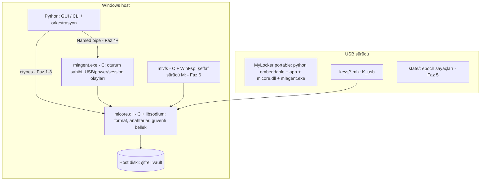
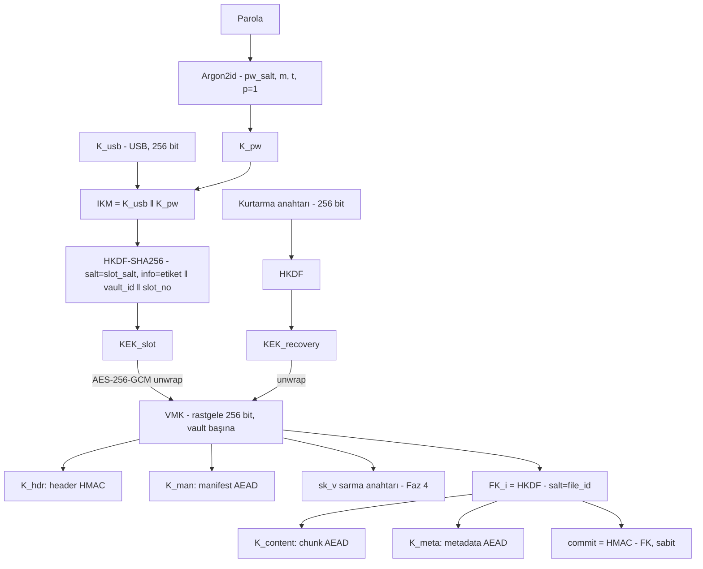

# MyLocker — Mimari ve Kriptografi Tasarımı (v0.1)

> Bu belgedeki her karar bir **ADR (Architecture Decision Record)** olarak §10'da özetlenir. Format alanları "taslak"tır; Faz 1 sonunda test vektörleriyle birlikte dondurulur.

---

## 1. Genel mimari (hedef durum)



Fazlara göre evrim:

| Faz | Anahtarların yaşadığı süreç | Kullanıcı erişim modeli |
|---|---|---|
| 1 | Python (referans impl., yalnızca test amaçlı) | CLI: lock / unlock |
| 2–3 (MVP) | `mlcore.dll`, Python GUI sürecine yüklü | Çöz → düzenle → şifrele |
| 4 | `mlagent.exe` (GUI kapansa da yaşar) | Aynı + otomatik relock |
| 6 | `mlagent.exe` / `mlvfs` | Şeffaf sanal sürücü |

---

## 2. Python / C görev dağılımı

### 2.1 Dürüst performans değerlendirmesi
Python `cryptography` paketinin AES-GCM'i zaten OpenSSL (C, AES-NI) üzerinde çalışır. 64 KiB chunk ile Python çağrı ek yükü ihmal edilebilir. **Yani "kripto hızı" C kullanmak için geçerli bir gerekçe değildir.** Bu hipotez Faz 2'de P-03 testiyle ölçülecek ve tezde raporlanacak.

### 2.2 C'nin gerçek gerekçeleri

| Gerekçe | Açıklama |
|---|---|
| **Bellek güvenliği** | Python `bytes`/`str` değiştirilemez, GC kopyalar oluşturur, sıfırlanamaz. C'de `sodium_malloc` (guard page + `VirtualLock` + canary), `sodium_memzero`, `sodium_mprotect_noaccess` kullanılabilir. G4 hedefi C olmadan savunulamaz. |
| **Tek format implementasyonu** | GUI, agent ve VFS aynı `mlcore` kodunu kullanır. Format hatası tek yerde düzeltilir. |
| **Agent** | Python runtime'ı olmadan küçük, hızlı başlayan, saldırı yüzeyi az bir süreç. Windows mesaj döngüsü ve cihaz bildirimleri doğal. |
| **VFS callback'leri** | WinFsp her I/O isteği için callback çağırır; GIL ve Python çağrı maliyeti gecikmeyi artırır. |
| **Windows API** | Named pipe güvenliği, Restart Manager, `CM_Register_Notification`, süreç azaltma politikaları C'den doğrudan. |

### 2.3 Python'un gerçek gerekçeleri
GUI (Tkinter → PySide6), CLI, yapılandırma, klasör tarama ve politika mantığı, **referans implementasyon**, test altyapısı (pytest + hypothesis), saldırı betikleri, benchmark analizi (pandas/matplotlib), FIDO2 (`python-fido2`).

### 2.4 Strateji: Referans → Üretim (diferansiyel doğrulama)
1. **Faz 1:** Format Python'da (`cryptography` + `argon2-cffi`) yazılır → hızlı iterasyon, spesifikasyon olgunlaşır, **test vektörleri** üretilir.
2. **Faz 2:** Aynı format C'de (`libsodium`) yazılır. Enjekte edilmiş deterministik RNG ile iki implementasyon **bayt bayt aynı** çıktıyı üretmek zorundadır; biri diğerinin şifrelediğini açmalıdır.
3. Python referansı üretimde kullanılmaz, test oracle'ı olarak kalır.

Bu, akademik olarak savunulabilir bir doğrulama yöntemidir (N-version / differential testing).

### 2.5 C ABI taslağı (anahtarlar sınırı asla geçmez)

```c
/* mlcore.h — tüm fonksiyonlar 0 = başarı, <0 = ml_err döner */
typedef struct ml_vault ml_vault;          /* opak; anahtarlar içeride, kilitli bellekte */

typedef struct {
    const wchar_t *usb_key_path;            /* USB'deki .mlk dosyası */
    const uint8_t *password; size_t password_len; /* çağrıdan sonra çağıran sıfırlar */
    uint32_t       flags;                   /* ML_PROMPT_PASSWORD_NATIVE: parolayı C okusun */
} ml_unlock_params;

int  ml_init(void);                                       /* sodium_init, DLL dizin sertleştirme */
int  ml_keyfile_create(const wchar_t *path, const char *label_utf8, uint8_t key_id_out[16]);
int  ml_vault_create(const wchar_t *vault_dir, const ml_unlock_params *p,
                     char *recovery_out, size_t recovery_cap, ml_vault **out);
int  ml_vault_open(const wchar_t *vault_dir, const ml_unlock_params *p, ml_vault **out);
int  ml_vault_list(ml_vault *v, ml_entry_cb cb, void *ctx);
int  ml_vault_import(ml_vault *v, const wchar_t *src, const char *rel_path_utf8);
int  ml_vault_extract(ml_vault *v, const char *rel_path_utf8, const wchar_t *dst);
int  ml_vault_commit(ml_vault *v);                         /* atomik */
void ml_vault_close(ml_vault *v);                          /* tüm anahtarları sıfırlar */
const char *ml_strerror(int err);
```

Python bağlama: **ctypes** (bağımlılık yok, portable). Alternatif: `cffi` ABI modu.

---

## 3. USB anahtar mekanizması

### 3.1 "Key Provider" soyutlaması
Vault, birden çok anahtar slotu taşır; her slot bir sağlayıcı türüne bağlıdır:

| Tür | Faktörler | Klonlanabilir mi? | Faz |
|---|---|---|---|
| `USB_KEYFILE` | USB'deki 256-bit `K_usb` | Evet | 1 |
| `USB_KEYFILE_PASSWORD` **(varsayılan)** | `K_usb` + parola (Argon2id) | Dosya evet, ama parola gerekir | 1 |
| `RECOVERY` | 256-bit kurtarma anahtarı (yazdırılır) | — | 3 |
| `FIDO2_HMAC_SECRET` | Donanım token'ı (YubiKey vb.) + PIN + dokunma | **Hayır** (sır token dışına çıkmaz) | 5 (opsiyonel) |

### 3.2 Neden sıradan USB bellek "gerçek" bir donanım anahtarı değildir
Sıradan USB bellek yalnızca **depolamadır**. İçindeki her bayt kopyalanabilir; dolayısıyla "USB'ye sahip olmak" kriptografik olarak "anahtar dosyasına sahip olmak"tır. Bu yüzden:

- **Varsayılan mod 2FA'dır** (USB + parola). Kullanıcının listelediği "USB takılıyken saldırı" ve "USB içeriğini kopyalama" senaryolarına karşı tek savunma budur.
- **USB seri numarasına bağlama güvenlik sağlamaz:** Seri numarası her programca okunabilir (`IOCTL_STORAGE_QUERY_PROPERTY`), birçok denetleyicide değiştirilebilir ve kopyalanmış bir anahtar dosyasıyla birlikte taklit edilebilir. Yalnızca "yanlış USB" uyarısı için UX kontrolü olarak kullanılabilir; tezde bu açıkça "güvenlik özelliği değildir" diye belirtilmelidir.
- Anahtarı ayrılmamış sektörlere/gizli bölümlere saklamak **belirsizlik yoluyla güvenliktir** (security through obscurity); kullanılmayacak.
- Gerçek klonlanamazlık için **FIDO2 `hmac-secret`** uzantısı: token içindeki cihaz sırrı ile `HMAC(cihaz_sırrı, salt)` hesaplanır, sır asla dışarı çıkmaz. *Not:* Ele geçirilmiş bir host, oturum sırasında belirli bir salt için çıktıyı yakalayabilir (TA2 ihlali); bu da tezde belirtilmelidir. Windows'ta yönetici olmayan kullanıcılar FIDO cihazlarına `webauthn.dll` üzerinden erişir; `hmac-secret`/PRF desteğinin Windows API sürümüyle ilişkisi Faz 5 başında doğrulanmalıdır.

### 3.3 USB keşfi
1. `FindFirstVolumeW` / `GetDriveTypeW == DRIVE_REMOVABLE` ile çıkarılabilir hacimleri listele (sürücü harfine bağımlı olma).
2. Her hacimde `\MyLocker\keys\*.mlk` ara; `key_id`'yi vault slotlarıyla eşleştir.
3. Eşleşen anahtar yoksa net hata ("bu vault için anahtar bulunamadı"), eşleşen varsa unwrap dene.

### 3.4 Anahtar dosyası formatı (`.mlk`)

| Ofset | Boyut | Alan |
|---|---|---|
| 0 | 8 | magic `"MLKEY\0\0\0"` |
| 8 | 2 | version = 1 |
| 10 | 2 | flags |
| 12 | 16 | `key_id` (rastgele, gizli değil) |
| 28 | 32 | `K_usb` (CSPRNG) |
| 60 | 8 | created (unix) |
| 68 | 8 | `check = HKDF(K_usb, info="MyLocker/v1/keycheck")[0..8]` — bozulma teşhisi |
| 76 | 2+n | label (UTF-8) |

---

## 4. Kriptografik mimari

### 4.1 Primitive seçimleri

| İhtiyaç | Seçim | Gerekçe | Alternatif |
|---|---|---|---|
| İçerik AEAD | **AES-256-GCM** (NIST SP 800-38D) | Donanım hızlandırma (AES-NI), standart, kullanıcı tercihi | **XChaCha20-Poly1305** (192-bit nonce, AES-NI'sız CPU'da sabit zamanlı) — header'da `alg` alanı ile desteklenir |
| KDF (anahtardan anahtar) | **HKDF-SHA256** (RFC 5869) | Extract-then-expand, alan ayrımı `info` etiketleriyle | — |
| Parola KDF | **Argon2id** (RFC 9106) | Bellek-zor, GPU/ASIC'e dirençli, PHC kazananı | scrypt |
| MAC | HMAC-SHA256 | Header bütünlüğü, anahtar taahhüdü | — |
| Asimetrik "yalnızca kilitleme" (Faz 4) | X25519 tabanlı sealed box (libsodium `crypto_box_seal`) veya **HPKE** (RFC 9180) | Açma yeteneği olmadan şifreleme | — |
| RNG | libsodium `randombytes_buf` → Windows OS CSPRNG | TA4 | `BCryptGenRandom` |

**Kütüphane:** `libsodium` (ISC lisansı, denetlenmiş, kötüye kullanıma dirençli API, Argon2id + HKDF + AES-GCM + güvenli bellek tek pakette; vcpkg ile kurulur). Referans: `cryptography` + `argon2-cffi`.

> [!IMPORTANT]
> **Uyumluluk tuzağı:** libsodium'un `crypto_pwhash` Argon2id implementasyonu yalnızca **paralellik p = 1** destekler. İki implementasyonun aynı çıktıyı vermesi için format `p = 1` sabitler; güvenlik `m` (bellek) ve `t` (iterasyon) ile ayarlanır. Ayrıca libsodium AES-256-GCM yalnızca donanım desteği varsa çalışır (`crypto_aead_aes256gcm_is_available()`); yoksa XChaCha20-Poly1305'e düşülür.

Başlangıç Argon2id parametresi: `m = 256 MiB, t = 3, p = 1`; hedef makinede ~0,5–1 s olacak şekilde ölçülerek ayarlanır. Minimum (downgrade koruması): `m ≥ 64 MiB, t ≥ 3`.

### 4.2 Anahtar hiyerarşisi



Tüm `info` etiketleri sabit ve benzersizdir: `"MyLocker/v1/kek"`, `"MyLocker/v1/header-mac"`, `"MyLocker/v1/manifest"`, `"MyLocker/v1/file"`, `"MyLocker/v1/content"`, `"MyLocker/v1/meta"`, `"MyLocker/v1/commit"`.

### 4.3 Hiyerarşinin avantajları ve dezavantajları

| Avantaj | Açıklama |
|---|---|
| Parola / USB değişimi ucuz | Yalnızca VMK yeniden sarılır; veri yeniden şifrelenmez (LUKS keyslot modeli). |
| Çoklu anahtar | Yedek USB, kurtarma anahtarı, FIDO2 aynı vault'u açabilir. |
| Anahtar ayrımı | Header, manifest, içerik farklı anahtarlarla; bir bağlamdaki hata diğerine taşınmaz. |
| Anahtar başına veri sınırı | Her dosya kendi anahtarıyla şifrelenir → GCM nonce/hacim sınırları pratikte sorun olmaz. |
| Bölümlendirme | İleride klasör başına alt anahtar (paylaşım) mümkün. |

| Dezavantaj | Açıklama / Azaltım |
|---|---|
| VMK tek hata noktası | VMK sızarsa tüm vault açılır → G4 bellek kontrolleri. |
| Header tek hata noktası (erişilebilirlik) | Header bozulursa veri kaybı → header yedeği (`vault.mlv.bak`, USB'de kopya). |
| **İptal geçmişe işlemez** | İptal edilen USB + eski header kopyası eski VMK'yı açar. Gerçek iptal = **VMK rotasyonu + tam yeniden şifreleme** (R-5). |
| Karmaşıklık | Daha fazla kod, daha fazla test vektörü. |

### 4.4 Nonce yönetimi
- Her şifreleme işleminde yeni rastgele `file_id` (32 bayt) → yeni `FK`. Aynı anahtarla tekrar kullanım olmaz.
- Chunk başına **rastgele 96-bit nonce** chunk'ın önünde saklanır. Neden sayaç değil? Faz 6'da VFS bir chunk'ı yerinde yeniden yazacaktır; sayaç tabanlı nonce aynı `(FK, indeks)` için nonce tekrarı (GCM'de felaket: anahtar akışı sızıntısı + sahtecilik) üretirdi. Rastgele nonce ile tek anahtar başına NIST sınırı 2^32 şifrelemedir; 64 KiB chunk ile bu 256 TiB'a karşılık gelir.
- Sıralama/kesme koruması nonce'tan değil **AAD**'den gelir (STREAM yapısı fikri, Hoang vd. 2015; `age` formatına benzer).

### 4.5 Anahtar taahhüdü (key commitment)
AES-GCM anahtara bağlayıcı (key-committing) değildir: aynı şifreli metni iki farklı anahtarla geçerli çözmek mümkündür (Albertini vd. 2022; Len vd. 2021 "partitioning oracle"). Tek anahtarlı senaryoda risk düşüktür ama ucuza kapatılır: header'da `commit = HMAC-SHA256(FK, "MyLocker/v1/commit")` saklanır ve çözmeden önce sabit zamanlı karşılaştırılır.

---

## 5. Vault ve dosya formatı (taslak v0.1)

### 5.1 Dizin yapısı
Kullanıcı `D:\Projeler\Gizli` klasörünü seçer:

```text
D:\Projeler\Gizli\
 ├── .mylocker\
 │    ├── vault.mlv          ← header + şifreli manifest (TEK dosya → atomik değiştirme)
 │    ├── vault.mlv.bak      ← bir önceki commit
 │    └── d\
 │         ├── 3f\3fa94c…e1.mlf   ← rastgele adlı şifreli blob'lar (2 karakterle bölümlenmiş)
 │         └── a0\a0c7…19.mlf
 ├── OKUBENI.txt             ← "Bu klasör MyLocker ile korunuyor"
 └── (kilit açıkken) çalışma kopyaları — MVP
```

Dosya adları ve klasör yapısı yalnızca şifreli manifestte bulunur → AS-2 korunur.

### 5.2 `vault.mlv`

| Alan | Boyut | Not |
|---|---|---|
| magic `"MLVAULT\0"` | 8 | |
| format_version | 2 | = 1 |
| flags | 2 | |
| vault_id | 16 | rastgele |
| created | 8 | |
| epoch | 8 | her commit'te +1 (rollback tespiti, Faz 5) |
| content_alg | 1 | 1 = AES-256-GCM, 2 = XChaCha20-Poly1305 |
| chunk_log2 | 1 | 16 → 64 KiB |
| pk_v | 32 | Faz 4 (yoksa sıfır) |
| sk_v_wrapped | 12+32+16 | Faz 4: `AEAD(K_sk, sk_v)` |
| slot_count | 1 | |
| slots[] | n × 128 | aşağıda |
| manifest_len | 4 | |
| manifest | değişken | `nonce ‖ AEAD(K_man, CBOR manifest) ‖ tag`, AAD = header baytları |
| header_mac | 32 | `HMAC(K_hdr, önceki tüm baytlar)` |

**Slot:** `slot_type(1) ‖ flags(1) ‖ key_id(16) ‖ slot_salt(32) ‖ pw_salt(16) ‖ argon_m_kib(4) ‖ argon_t(4) ‖ nonce(12) ‖ wrapped_vmk(32+16)` (+ dolgu). Wrap AAD = `vault_id ‖ slot_no ‖ slot_type ‖ key_id ‖ argon parametreleri` → parametre manipülasyonu unwrap'i bozar.

**Manifest girdisi:** `{path (UTF-8, normalize), file_id, blob_name, size, mtime, attrs, header_hash}`. `header_hash` blob header'ının SHA-256'sıdır → yol ↔ blob bağı; dosya takası/silinmesi tespit edilir.

### 5.3 Dosya blob'u (`.mlf`)

| Alan | Boyut |
|---|---|
| magic `"MLFILE\0\0"` | 8 |
| version | 2 |
| content_alg | 1 |
| chunk_log2 | 1 |
| key_wrap_type | 1 — 1 = HKDF(VMK, file_id) türetilmiş; 2 = `pk_v` ile sealed (Faz 4) |
| reserved | 3 |
| vault_id | 16 |
| file_id | 32 |
| key_commit | 32 |
| wrap_len + wrapped_fk | 2 + n (tip 1'de n = 0) |
| meta_len + meta | 4 + (12 + m + 16) — orijinal ad, boyut, zamanlar |
| chunk[0..N-1] | her biri `nonce(12) ‖ ct(≤64 KiB) ‖ tag(16)` |

`H = SHA-256(header + meta baytları)`. Chunk `i` için `AAD_i = H ‖ u64_le(i) ‖ u8(is_last)`.

- **Kesme:** son chunk'lar atılırsa yeni son chunk'ta `is_last=1` olmadığından tespit edilir.
- **Ekleme:** `is_last=1` chunk'tan sonra veri varsa red.
- **Sıralama/çoğaltma:** indeks AAD'de.
- **Boş dosya:** tek chunk, 0 bayt, `is_last=1` (test edilmesi gereken kenar durum).
- **Ek yük:** 64 KiB başına 28 bayt (%0,04) + ~200 bayt header.

### 5.4 Atomik commit protokolü (G5)

```text
1. Yeni/değişen dosyaları şifrele → d\xx\<rastgele>.mlf.tmp → FlushFileBuffers → yeniden adlandır
2. Doğrulama geçişi: yeni blob'u çöz, düz metin hash'iyle karşılaştır
3. Yeni vault.mlv'yi vault.mlv.tmp'ye yaz → FlushFileBuffers
4. ReplaceFileW(vault.mlv, vault.mlv.tmp, vault.mlv.bak)   ← TEK atomik commit noktası
5. Ancak bundan sonra: düz metin çalışma kopyalarını sil (best-effort üzerine yazma)
6. Bir sonraki açılışta: manifestte olmayan blob'lar = çöp → sil
```
Herhangi bir adımda çökme: ya eski ya yeni tutarlı durum. Düz metin, şifreli kopyası doğrulanıp commit edilmeden asla silinmez.

### 5.5 Dosya sistemi güvenliği (savunmacı kodlama)
- Reparse point'ler (junction/symlink) **takip edilmez** (`FILE_FLAG_OPEN_REPARSE_POINT`), tespit edilince işlem reddedilir.
- Çıkarma sırasında yol doğrulama: `..`, mutlak yol, sürücü harfi, `:` (ADS), rezerve adlar (`CON`, `NUL`, `COM1`…), sondaki nokta/boşluk reddedilir; büyük/küçük harf çakışmaları kontrol edilir ("zip-slip" sınıfı).
- Uzun yollar: `\\?\` öneki.
- Alternate Data Streams: kilitleme sırasında tespit edilir; MVP'de uyarı + atlanır (aksi halde sızıntı).
- Kullanımda olan dosyalar: kilitlemeden önce Restart Manager ile tespit.

---

## 6. Agent mimarisi (Faz 4)

### 6.1 Temel ilke
**Agent bir güvenlik sınırı değildir.** Güvenlik sınırı kriptografidir. Agent; hijyen (anahtar sıfırlama, relock) ve kullanılabilirlik bileşenidir. USB yokken agent'ın elinde hiçbir sır yoktur → onu durdurmak, yamalamak veya IPC'sini manipüle etmek **durağan veriyi açmaz**. "Kilidi bypass et" diye bir IPC komutu var olamaz çünkü yetenek (anahtar) yoktur.

### 6.2 Kurulum modeli
- Agent **USB'den çalışır** (`mlagent.exe`), host'a kurulmaz → ADV-5'in kalıcı yama yapacağı bir host binary'si yoktur.
- Kullanıcı başına normal süreç; **SYSTEM servisi yok.** Gerekçe: IPC dinleyen bir SYSTEM servisi, standart kullanıcılar (ADV-1) için yerel yetki yükseltme (LPE) hedefi olur ve G7'yi ihlal eder. Servis yalnızca Faz 7'de süreç engelleme için gerekirse değerlendirilecek.

### 6.3 Olay kaynakları

| Olay | API | Tepki |
|---|---|---|
| Güvenli çıkarma isteği | `RegisterDeviceNotificationW` (`DBT_DEVTYP_HANDLE`) → `DBT_DEVICEQUERYREMOVE` | **Çıkarmadan önce** relock; handle'ı kapat ki çıkarma başarılı olsun |
| Ani çıkarma | `CM_Register_Notification` / `DBT_DEVICEREMOVECOMPLETE` | Anahtarları hemen sıfırla, `pk_v` ile relock |
| Yedek kontrol | 500 ms'de bir anahtar dosyası erişilebilir mi | Aynı |
| Uyku / hazırda bekletme | `WM_POWERBROADCAST` (`PBT_APMSUSPEND`) | Kilitle + sıfırla (hiberfil'e anahtar yazılmasın) |
| Oturum kilidi / çıkış | `WTSRegisterSessionNotification` | Politikaya göre kilitle |
| Hareketsizlik | Zamanlayıcı | Kilitle |
| Çalışma kopyası değişikliği | `ReadDirectoryChangesW` | Değişen dosyaları izle |

### 6.4 "Yalnızca kilitleme" anahtar çifti
Vault'ta bir X25519 anahtar çifti: `pk_v` header'da açık (HMAC ile doğrulanmış), `sk_v` VMK ile sarılı. USB çıkarıldığında:
1. VMK ve `sk_v` **hemen** sıfırlanır.
2. Agent, oturum başında doğruladığı `pk_v`'yi bellekte tutar; değişen çalışma kopyaları için yeni rastgele `FK` üretir, `pk_v` ile sarar (key_wrap_type = 2), şifreler, düz metni siler.
3. Bu blob'lar bir sonraki açılışta `sk_v` ile açılır ve manifest'e işlenir (manifest güncellemesi VMK gerektirdiğinden "bekleyen girdiler" `pending\` altında tutulur).

Risk: Admin, disk üzerindeki `pk_v`'yi kendi anahtarıyla değiştirirse yeni dosyalar ona şifrelenir → agent `pk_v`'yi diskten değil oturum başında doğruladığı bellekteki kopyadan kullanır.

### 6.5 Tepki politikası seviyeleri

| Seviye | Eylem |
|---|---|
| L0 | Yalnızca bildirim |
| L1 (varsayılan) | Anahtarları sıfırla + relock + çalışma kopyalarını sil |
| L2 (varsayılan) | L1 + `RmShutdown` ile uygulamalara kibarca kapanma isteği |
| L3 | L2 + handle tutan süreçleri zorla sonlandır |

### 6.6 Güvenli IPC

| Kontrol | Uygulama |
|---|---|
| İsimlendirme | `\\.\pipe\MyLocker-<kullanıcı SID>-<oturum rastgele>` |
| Squatting önleme | `FILE_FLAG_FIRST_PIPE_INSTANCE`; istemci `GetNamedPipeServerProcessId` + `QueryFullProcessImageNameW` ile sunucuyu doğrular |
| Erişim kontrolü | SDDL ile DACL: yalnızca mevcut kullanıcı SID'i; `PIPE_REJECT_REMOTE_CLIENTS` |
| İstemci doğrulama | `GetNamedPipeClientProcessId` → imaj yolu USB uygulama dizininde mi + hash |
| Protokol | Uzunluk önekli, versiyonlu, maksimum boyutlu; katı parser; fuzz testi |
| Sırlar | IPC üzerinden anahtar taşınmaz; parola tercihen agent'ın kendi istemiyle alınır |
| DLL güvenliği | `SetDefaultDllDirectories(LOAD_LIBRARY_SEARCH_SYSTEM32 | LOAD_LIBRARY_SEARCH_APPLICATION_DIR)` |

Bu kontroller ADV-1'e karşıdır. ADV-2/ADV-4'e karşı IPC sertleştirmesi anlamsızdır ve tezde bu şekilde açıklanmalıdır.

---

## 7. Sanal dosya sistemi (Faz 6)

### 7.1 Seçenekler

| Teknoloji | Mod | Diske düz metin yazar mı? | Karmaşıklık | Karar |
|---|---|---|---|---|
| **WinFsp** | Kullanıcı modu FS (FUSE benzeri), imzalı sürücü hazır | Hayır | Orta | ✅ **Seçildi** |
| Dokany | Kullanıcı modu FS | Hayır | Orta | Alternatif |
| ProjFS | İçerik sanallaştırma | **Evet** (hidrasyon) | Düşük | ❌ |
| Cloud Files API (cfapi) | OneDrive benzeri yer tutucular | **Evet** (hidrasyon) | Orta | ❌ |
| Minifilter (izolasyon filtresi, EFS benzeri) | Kernel | Hayır | **Çok yüksek** (cache tutarlılığı, sürücü imzalama) | ❌ Araştırma bölümü olarak |
| Tam kernel FSD | Kernel | Hayır | Aşırı | ❌ |

WinFsp: GPLv3 + FLOSS istisnası (açık kaynak tez için uygun), sürücü Microsoft imzalı gelir → test-signing gerekmez. Dosya sistemi kullanıcı sürecinde çalışabilir → SYSTEM servisi gerekmez.

### 7.2 Tasarım notları
- Rastgele erişimli okuma: ilgili chunk(lar) çözülür, kilitli bellekte LRU cache.
- Yazma: chunk oku-değiştir-yaz, **yeni rastgele nonce** (§4.4'ün gerekçesi).
- Dosya büyürken eski son chunk `is_last=0` ile yeniden şifrelenir.
- USB çıkarılınca: `FspFileSystemStopDispatcher` + unmount → tüm handle'lar geçersiz.
- Açık soru (R-8): Tek dosyalık manifest her metadata değişikliğinde yeniden yazılır; VFS'te bu yavaş olabilir → Faz 6 başında dizin başına metadata (gocryptfs/Cryptomator modeli) içeren **format v2** değerlendirilecek. Chunk formatı aynı kalacak şekilde tasarlandı.

---

## 8. Uygulama kilitleme (Faz 7)

| Yaklaşım | Admin'e karşı | Not |
|---|---|---|
| `.exe` gizleme / NTFS deny-execute | ❌ | Kullanıcı istemiyor, doğru |
| IFEO `Debugger` hilesi | ❌ | Tek registry değeri |
| AppLocker / WDAC | ❌ (politikayı değiştirebilir) | İmzalı WDAC politikası daha dirençli ama aşırı karmaşık |
| Kullanıcı modu süreç izleme (ETW `Microsoft-Windows-Kernel-Process`) + sonlandırma | ❌ | Yarış koşulu: süreç kısa süre çalışır |
| Kernel callback (`PsSetCreateProcessNotifyRoutineEx`) | ❌ (admin sürücüyü kaldırabilir) | EV imza / test-signing gerektirir |
| **Uygulama verisini şifrelemek** | ✅ | Kriptografik garanti |

**Temel içgörü:** Uygulamanın kendisi genellikle gizli değildir; admin aynı uygulamayı internetten yeniden indirebilir. Korunması gereken şey **uygulamanın verisidir** (Telegram `tdata`, tarayıcı profili, e-posta istemcisi veritabanı). Bu nedenle "Application Lock" = (1) uygulama veri klasörünün VFS üzerinden şeffaf vault'a taşınması [kriptografik, admin'e karşı geçerli] + (2) USB yokken uygulamanın başlatılmasını engelleyen politika katmanı [kullanılabilirlik, admin'e karşı geçersiz]. Bu ayrım tezde açıkça yapılmalıdır.

---

## 9. Taşınabilirlik ↔ güvenlik çelişkileri

| Çelişki | Açıklama | Karar |
|---|---|---|
| Kurulumsuz çalışma vs. VFS sürücüsü | WinFsp sürücüsü bir kez admin kurulumu ister | MVP + agent tamamen portable; VFS "kurulumlu mod" |
| Güvenilmeyen bilgisayarda kullanım | Yabancı PC'de keylogger/bellek okuma → TA2 ihlali | Kullanıcı uyarılır; FIDO2 parolayı korumaz ama klonlamayı önler |
| Python runtime | Host'ta Python olmayabilir | Python embeddable paketi USB'de; PyInstaller `--onefile` **kullanılmaz** (host `%TEMP%`'e açar) → `onedir` |
| Agent kalıcılığı | Kalıcı servis → daha iyi koruma ama ADV-5 hedefi + taşınabilirlik kaybı | Agent USB'den, oturum boyunca |
| Admin olmayan kullanıcı | Yabancı PC'de admin değilsen kurulum yapamazsın | Çekirdek işlevler admin gerektirmez |
| Antivirüs | İmzasız şifreleme aracı = fidye yazılımı sezgiseli | Kod imzalama (opsiyonel), dokümantasyon |
| USB kaybı | Taşınabilirlik → kaybolma riski | Kurtarma anahtarı zorunlu (G6) |
| Vault konumu | Vault host'ta, anahtar USB'de → vault başka PC'ye taşınabilir, ama veri USB'de değil | Vault'u USB'ye veya buluta koymak da güvenli (şifreli) |

---

## 10. ADR özeti

| ADR | Karar | Ana gerekçe |
|---|---|---|
| 01 | Güvenlik sınırı kriptografi; ACL değil | Admin ACL'yi değiştirebilir, `SeBackupPrivilege` |
| 02 | libsodium (C) + `cryptography` (Python referans); kendi primitive'imiz yok | Denetlenmiş, kötüye kullanıma dirençli API |
| 03 | AES-256-GCM varsayılan, XChaCha20-Poly1305 alternatif; 64 KiB chunk; chunk başına rastgele nonce | Donanım hızı; VFS'te yerinde yazma ile nonce tekrarını önleme |
| 04 | VMK + keyslot hiyerarşisi + dosya başına HKDF anahtarı | Rotasyon, çoklu anahtar, kurtarma |
| 05 | Varsayılan 2FA (USB + parola) | Sıradan USB klonlanabilir |
| 06 | Python referans → C üretim, diferansiyel test | Hızlı iterasyon + doğrulanabilirlik |
| 07 | Agent güvenlik sınırı değil; SYSTEM servisi yok | G7, LPE yüzeyi |
| 08 | WinFsp ile VFS; ProjFS/cfapi reddedildi | Diske düz metin yazmama |
| 09 | Uygulama kilitleme = uygulama verisi şifreleme + politika katmanı | Uygulama binary'si gizli değil |
| 10 | USB seri numarası güvenlik özelliği değil | Okunabilir/taklit edilebilir |
| 11 | DPAPI/TPM ana anahtar için kullanılmaz | Makineye/kullanıcıya bağlı → taşınabilirlik yok, host admin'i tehdit |
| 12 | Header + manifest tek dosya, `ReplaceFileW` ile atomik commit | G5 |
| 13 | Asimetrik "yalnızca kilitleme" anahtarı (Faz 4) | USB çıkınca anahtarı sıfırlayıp yine de relock |
