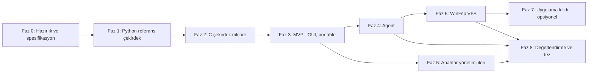

# MyLocker — MVP ve Faz Planı

## 1. Faz bağımlılık grafiği

Kritik yol: **0 → 1 → 2 → 3 → 4 → 8**. Faz 5, 6, 7 kritik yol dışındadır; zaman daralırsa bunlar kırpılır, tez yine eksiksiz kalır.

---

## 2. MVP tanımı

**MVP = Faz 3 sonu.** Bir cümleyle:

> Kullanıcı USB'den programı çalıştırıp bir klasörü USB anahtarı + parola ile kilitleyebilir; kilitli klasör admin dahil kimse tarafından USB olmadan okunamaz; aynı USB ile (başka bir bilgisayarda bile) kilit açılabilir ve çalışma kopyaları üzerinde düzenleme yapılıp yeniden kilitlenebilir.

### MVP'de VAR
- USB anahtar dosyası oluşturma, USB otomatik keşfi
- Vault oluşturma (klasörü içe aktarma), kilit açma (çalışma kopyalarına çıkarma), yeniden kilitleme (değişiklikleri commit)
- Vault içeriğini açmadan listeleme, tek dosya çıkarma
- 2FA varsayılan, kurtarma anahtarı, parola değiştirme, ikinci USB ekleme
- Bütünlük hatası raporlama (hangi dosya, hangi chunk)
- Atomik commit, çökme sonrası kurtarma
- Basit GUI (Tkinter) + CLI
- USB'den kurulumsuz çalışma
- Kilitleme sonrası düz metin için best-effort üzerine yazma + açık uyarı

### MVP'de BİLEREK YOK
| Yok | Neden | Ne zaman |
|---|---|---|
| USB çıkarılınca otomatik relock | Ayrı süreç ve olay altyapısı gerekiyor | Faz 4 |
| Şeffaf erişim | En karmaşık bileşen; önce format oturmalı | Faz 6 |
| Rollback tespiti | USB'de durum yönetimi | Faz 5 |
| Uygulama kilidi | VFS'e bağımlı | Faz 7 |
| Güzel UX | Öncelik 6 | Faz 3 sonrası iyileştirme |

---

## 3. Fazlar

### Faz 0 — Hazırlık ve spesifikasyon (2 hafta)
**Hedef:** Kod yazmadan önce güvenlik sözleşmesini ve formatı dondurmak.

| İş | |
|---|---|
| 0.1 | Tehdit modeli v1 gözden geçirme (danışmanla) |
| 0.2 | Format spesifikasyonu `docs/spec/format-v1.md` — bayt düzeyinde, 02 belgesindeki taslaktan |
| 0.3 | Repo, CMake + vcpkg + libsodium, Python ortamı, CI (GitHub Actions Windows runner) |
| 0.4 | Test VM'leri: Windows 11 ×2, snapshot, USB passthrough |
| 0.5 | Literatür okumaları: Czeskis 2008, age spec, gocryptfs format, LUKS2 keyslot |

**Çıktılar:** `format-v1.md`, `threat-model-v1.md` (repoda), boş ama CI'si yeşil repo, VM'ler.
**Çıkış kriteri:** Format belgesinden bağımsız biri (veya sen, kodsuz) bir blob'u kâğıt üzerinde çözebilecek kadar net.

---

### Faz 1 — Python referans çekirdek (3 hafta)
**Hedef:** Formatı doğru ve test edilebilir hale getirmek. Hız değil, **doğruluk**.

| İş | |
|---|---|
| 1.1 | `mlref/keyfile.py`: `.mlk` üretme/okuma |
| 1.2 | `mlref/kdf.py`: Argon2id (p=1), HKDF etiketleri |
| 1.3 | `mlref/blob.py`: chunk'lı AES-GCM şifreleme/çözme, AAD, son chunk bayrağı, anahtar taahhüdü |
| 1.4 | `mlref/vault.py`: header, slotlar, manifest (CBOR), commit protokolü |
| 1.5 | `mlref/cli.py`: `keygen`, `init`, `lock`, `unlock`, `ls`, `extract`, `verify` |
| 1.6 | Enjekte edilebilir RNG → **deterministik test vektörleri** (`tests/vectors/*.json`) |
| 1.7 | pytest + hypothesis: round-trip, bit-flip (T-05), chunk manipülasyonu (T-06, T-07), downgrade (T-09) |
| 1.8 | Path traversal / kötü niyetli vault testleri (T-10) |

**Çıktılar:** Çalışan CLI, test vektörleri, %90+ kapsam, format-v1 **donduruldu** etiketi.
**Çıkış kriteri:** T-05, T-06, T-07, T-09, T-10 yeşil. Formatta değişiklik gerekiyorsa *şimdi* yapılır; sonrası pahalı.

> [!NOTE]
> Bu fazda anahtarlar Python belleğinde durur → G4 ihlali. Bilinçli: referans implementasyon üretim kodu değildir.

---

### Faz 2 — C çekirdek `mlcore` (4 hafta)
**Hedef:** Aynı formatı bellek güvenliği sağlayan C kodunda, test vektörleriyle doğrulanmış biçimde implement etmek.

| İş | |
|---|---|
| 2.1 | `secmem.c`: `sodium_malloc`/`sodium_free` sarmalayıcı, anahtarlar için `noaccess`/`readonly` geçişleri |
| 2.2 | `keyfile.c`, `kdf.c`, `blob.c`, `vault.c`, `manifest.c` (minimal CBOR — tinycbor veya elle sınırlı alt küme) |
| 2.3 | `fsutil_win.c`: `\\?\` yollar, reparse point reddi, `ReplaceFileW` commit, `FlushFileBuffers` |
| 2.4 | `mlcore.h` ABI (02 belgesi §2.5), `mlcore.dll` dışa aktarımları |
| 2.5 | `mlcore/py/mlcore.py`: ctypes bağlaması |
| 2.6 | **Diferansiyel test (T-12):** C ↔ Python çapraz şifreleme/çözme, vektör eşitliği |
| 2.7 | Fuzz hedefleri: `fuzz_header`, `fuzz_blob`, `fuzz_manifest` (libFuzzer) |
| 2.8 | ASan/UBSan ile tüm test takımı; `/analyze`, clang-tidy |
| 2.9 | P-01, P-02, P-03, P-04 ilk ölçümler |

**Çıktılar:** `mlcore.dll`, ctypes bağlaması, fuzz harness'ları, ilk benchmark raporu (P-03: "C hız için gerekli miydi?" sorusunun cevabı).
**Çıkış kriteri:** T-12 yeşil; fuzz ≥ 4 saat çökme yok; ASan temiz.

---

### Faz 3 — MVP: GUI, anahtar yönetimi, taşınabilirlik (3 hafta)
| İş | |
|---|---|
| 3.1 | Tkinter GUI: USB seç, klasör seç, Kilitle / Kilidi Aç / Kilitle (değişiklikleri kaydet), vault içeriği |
| 3.2 | Parolayı C tarafında alma seçeneği (R-6) — `CredUIPromptForWindowsCredentialsW` veya kendi küçük diyalog |
| 3.3 | Kurtarma anahtarı (Base32/grup formatı + kontrol toplamı), ek USB slotu, slot kaldırma, parola değiştirme |
| 3.4 | Kilitleme öncesi kontroller: açık dosyalar (Restart Manager), ADS, reparse point, OneDrive klasörü, VSS varlığı → uyarı |
| 3.5 | Kilitleme sonrası best-effort üzerine yazma + SSD uyarısı |
| 3.6 | Çökme kurtarma: `.tmp` artıkları ve yetim blob temizliği |
| 3.7 | Portable paket: Python embeddable + app + `mlcore.dll` → `USB:\MyLocker\` |
| 3.8 | T-01, T-02, T-03, T-04, T-11, T-20 (fault injection) |

**Çıktılar:** **MVP sürümü v0.1**, kullanım kılavuzu, ara rapor (dönem sonu raporu için uygun).
**Çıkış kriteri:** D1, D2, D3, D6, D7, D8 demoları çalışıyor; B1–B4 sağlanıyor.

---

### Faz 4 — Agent ve oturum güvenliği (4 hafta)
| İş | |
|---|---|
| 4.1 | `mlagent.exe`: gizli pencere + mesaj döngüsü, `mlcore` statik bağlı |
| 4.2 | Cihaz olayları: `DBT_DEVICEQUERYREMOVE` (USB handle'ı kapat → çıkarmaya izin ver), ani çıkarma, polling yedeği |
| 4.3 | Uyku/hazırda bekletme, oturum kilidi, hareketsizlik zamanlayıcısı |
| 4.4 | Format uzantısı: `pk_v`/`sk_v` ("yalnızca kilitleme"), `pending\` kuyruğu (02 belgesi §6.4) |
| 4.5 | Çalışma kopyası izleme (`ReadDirectoryChangesW`) |
| 4.6 | Tepki politikaları L0–L3, Restart Manager ile uygulama kapatma |
| 4.7 | Named pipe IPC + protokol + fuzz (T-19); GUI artık agent istemcisi |
| 4.8 | T-14–T-18, T-21 (açık dosya tablosu), P-08 |

**Çıktılar:** v0.2, açık dosya davranış raporu (uygulama başına tablo — tezde ayrı bölüm), agent güvenlik analizi.
**Çıkış kriteri:** D4 demosu (VFS'siz versiyon); B5, B6 sağlanıyor.

---

### Faz 5 — İleri anahtar yönetimi (2–3 hafta, paralel yapılabilir)
| İş | |
|---|---|
| 5.1 | Rollback tespiti: USB'de `state/<vault_id>` → `epoch` + HMAC; vault epoch < USB epoch → uyarı (T-08) |
| 5.2 | VMK rotasyonu (tam yeniden şifreleme, kesintiye dayanıklı) → R-5'in gerçek çözümü |
| 5.3 | (Opsiyonel) FIDO2 `hmac-secret` sağlayıcı (D9) |

**Çıktılar:** v0.3, anahtar yaşam döngüsü bölümü.

---

### Faz 6 — WinFsp sanal dosya sistemi (5–6 hafta)

#### Neden bu fazda — ne erken, ne geç?
| Erken yapılmamalı çünkü | Geç bırakılmamalı çünkü |
|---|---|
| Format oturmadan VFS yazmak, her format değişikliğinde VFS'i baştan yazmak demek | Tezin ana deneyi (T-13: MVP vs VFS adli karşılaştırma) VFS gerektirir |
| VFS hataları **veri kaybına** yol açar; çekirdek önce kanıtlanmalı (fuzz, diferansiyel test) | Açık dosya probleminin tek gerçek çözümü (handle iptali) VFS'tedir |
| Agent'ın olay altyapısı (USB çıkınca unmount) VFS'in ön koşuludur | Performans karşılaştırması (P-09, P-10) zaman ister |
| Faz 1–4 tek başına savunulabilir bir tez; VFS "risk" değil "bonus" kalmalı | |

**Tetikleyici koşul:** Faz 4 çıkış kriteri sağlanmış ve takvimde ≥ 8 hafta kalmışsa başlanır; aksi halde salt-okunur VFS (6a) ile sınırlanır.

| Alt faz | İş | Çıktı |
|---|---|---|
| 6a | **Salt-okunur** sürücü: manifest → dizin ağacı, chunk bazlı rastgele okuma, LRU chunk cache (kilitli bellek) | Explorer'da M: sürücüsünde dosyalar açılabiliyor |
| 6b | Format v2 kararı (R-8): manifest ölçeklenmesi, dizin başına metadata mı? | ADR-14 |
| 6c | **Okuma-yazma:** oluştur, yaz (oku-değiştir-yaz, yeni nonce), yeniden adlandır, sil, truncate; WAL/journal ile atomiklik | Word/VS Code ile düzenleme |
| 6d | Agent entegrasyonu: USB çıkınca dispatcher durdur + unmount + Restart Manager | D4 tam versiyon |
| 6e | T-13 adli deney, T-21 tekrar, P-09, P-10 | Tezin ana deney bölümü |

**Çıkış kriteri:** Fault injection (T-20) VFS üzerinde de veri kaybı 0; D5 demosu.

---

### Faz 7 — Uygulama kilidi (opsiyonel, 2–3 hafta)

#### Neden en sonda?
1. Kriptografik olarak anlamlı tek yaklaşım **uygulama verisini vault'a koymaktır** (02 belgesi §8) → şeffaf erişim (Faz 6) olmadan uygulamalar şifreli dosyayla çalışamaz.
2. Başlatma engelleme admin'e karşı güvenlik sağlamaz → kullanıcının öncelik sırasında en altta.
3. Tezde "politika ≠ kriptografi" ayrımını göstermek için küçük ama öğretici bir vaka çalışması olarak yeterli.

| İş | |
|---|---|
| 7.1 | Uygulama profili: exe yolu + veri klasör(ler)i (ör. `%APPDATA%\Telegram Desktop\tdata`) |
| 7.2 | Veri klasörünü vault'a taşı, orijinal konuma VFS bağlama (junction → M:\apps\telegram veya WinFsp dizin bağlama) |
| 7.3 | Başlatma politikası: agent ETW ile süreç oluşmasını izler, USB yoksa sonlandırır (yarış koşulu belgelenir) |
| 7.4 | Analiz: AppLocker/WDAC/IFEO/kernel callback karşılaştırma tablosu (araştırma bölümü) |

**Faz 6 tamamlanmadıysa:** Faz 7 yalnızca **araştırma/tasarım bölümü** olarak teze girer (kod yok).

---

### Faz 8 — Değerlendirme ve tez yazımı (4 hafta + sürekli)
| İş | |
|---|---|
| 8.1 | Tüm T-xx ve P-xx testlerinin son sürümde tekrarı, ham veri + betikler |
| 8.2 | Fuzz ≥ 24 saat (B8) |
| 8.3 | Benzer sistemlerle karşılaştırma tablosu (VeraCrypt, Cryptomator, BitLocker USB key, EFS) |
| 8.4 | Tehdit modeli final: her senaryo için kanıt |
| 8.5 | Demo provası, demo VM snapshot'ları, yedek video kaydı |

> [!TIP]
> Tez yazımı Faz 8'e bırakılmamalı: her faz sonunda ilgili bölümün taslağı yazılır (aşağıdaki eşleme).

---

## 4. Takvim (iki dönem ≈ 28–30 hafta)

| Hafta | Faz | Kilometre taşı |
|---|---|---|
| 1–2 | 0 | Format spec v1, repo, VM'ler |
| 3–5 | 1 | Referans çekirdek, test vektörleri, format donduruldu |
| 6–9 | 2 | `mlcore.dll`, diferansiyel test yeşil |
| 10–12 | 3 | **MVP v0.1 — 1. dönem ara raporu / sunumu** |
| 13–16 | 4 | Agent v0.2 |
| 15–17 | 5 | (paralel) Rollback, VMK rotasyonu |
| 17–22 | 6 | VFS v0.4 |
| 23–24 | 7 | (opsiyonel) Uygulama kilidi |
| 25–28 | 8 | Değerlendirme, tez, demo |

### Kapsam kırpma sırası (gecikme olursa)
1. Faz 7 → yalnızca araştırma bölümü
2. FIDO2 (5.3) → gelecek çalışma
3. Faz 6c (okuma-yazma) → yalnızca 6a salt-okunur VFS + T-13 deneyi salt-okunur modda
4. VMK rotasyonu (5.2) → belgelenir
5. **Asla kırpılmaz:** Faz 1–4, T-05/T-12/T-20, tehdit modeli

---

## 5. Fazlar ↔ tez bölümleri

| Tez bölümü | Kaynak faz |
|---|---|
| 1. Giriş, problem tanımı | 0 |
| 2. Arka plan: Windows güvenlik modeli, NTFS/ACL, AEAD, KDF | 0, 04 belgesi |
| 3. İlgili çalışmalar | 0, 8 |
| 4. Tehdit modeli ve güvenlik hedefleri | 0 (+ her faz günceller) |
| 5. Tasarım: anahtar hiyerarşisi, format, commit protokolü | 1 |
| 6. Uygulama: Python/C mimarisi, güvenli bellek, diferansiyel doğrulama | 2, 3 |
| 7. Oturum güvenliği: agent, IPC, açık dosya problemi | 4 |
| 8. Şeffaf erişim: VFS | 6 |
| 9. Güvenlik değerlendirmesi | 8 (+ her faz) |
| 10. Performans değerlendirmesi | 2, 6, 8 |
| 11. Sınırlamalar ve gelecek çalışma (uygulama kilidi, minifilter) | 7, 8 |
